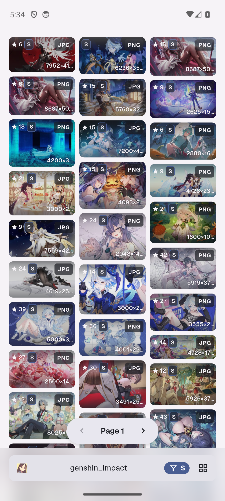
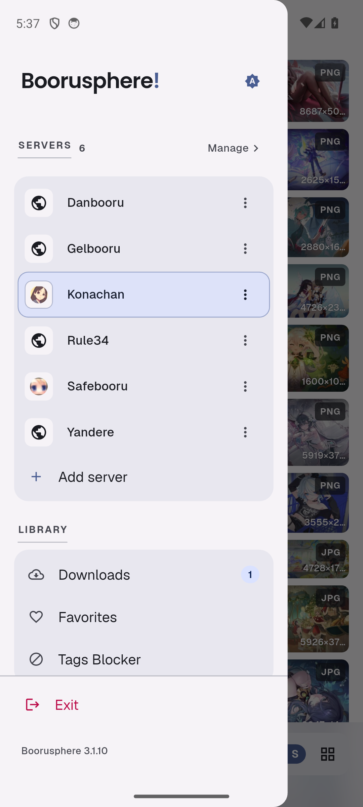
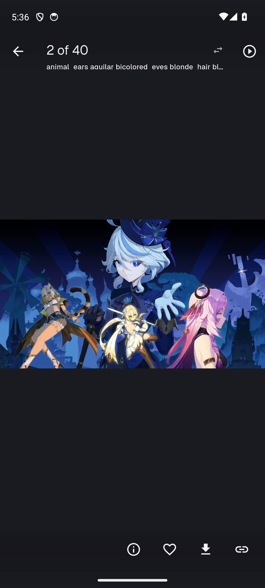
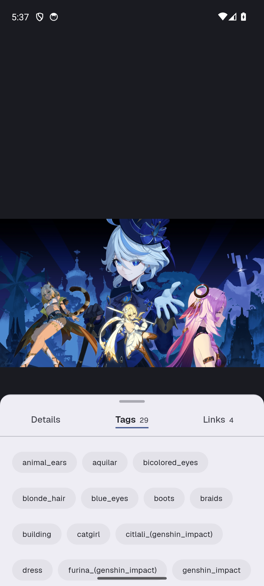

<div align="center">
    
    <h1>Boorusphere</h1>
    <p><b>Your boorus. One quiet app.</b></p>
    <p>A content-first booru viewer for Android.<br>
    The art fills the screen; everything else waits its turn.</p>
    <p>
        <a href="https://github.com/azrim/boorusphere/stargazers">
            
        </a>
        <a href="https://github.com/azrim/boorusphere/releases/latest">
            
        </a>
        <a href="https://github.com/azrim/boorusphere/actions">
            
        </a>
        <a href="https://github.com/azrim/boorusphere/blob/main/LICENSE.md">
            
        </a>
    </p>
    <p>
        <a href="https://github.com/azrim/boorusphere/releases/latest">
            
        </a>
    </p>
    <p><sub>Android 7.0+ · arm64, armv7, x86_64 or universal</sub></p>
</div>

## The short version

Boorusphere connects the booru boards you already browse to one quiet Android app. Pick a board, search by tag, scroll a staggered grid, open a post into a viewer that knows when to get out of the way. Zoom, pan, play, favorite, download, next.

Danbooru, Gelbooru, Konachan, e621, Derpibooru, Rule34 Paheal and the board you host yourself all open in the same grid; the engine list takes care of the API underneath. No account, no analytics, and no server of ours in the middle: favorites, blocklists, settings and backups stay on your device — or in a Telegram chat you own.

## A look around

<p align="center">
    <a href="fastlane/metadata/android/en-US/images/phoneScreenshots/1.png"></a>
    <a href="fastlane/metadata/android/en-US/images/phoneScreenshots/2.png"></a>
    <a href="fastlane/metadata/android/en-US/images/phoneScreenshots/3.png"></a>
    <a href="fastlane/metadata/android/en-US/images/phoneScreenshots/4.png"></a>
</p>
<p align="center"><sub>The feed, the drawer, a post in the viewer, and the tags behind it — Boorusphere 3.1.10, day and dark.</sub></p>

## The grid does the talking

Every thumbnail carries its score, rating, format and dimensions, so most decisions are made before you open anything; a video adds its own mark. Search suggestions come from the board itself, and the history keeps your recent queries with an undo for the row you just deleted. Rating filters are per server: one board can stay safe while another stays unfiltered.

The Tags Blocker takes expressions, not just single tags: a space means AND, `~` means OR, and `-` excludes. A page emptied by a filter says which one hid it and offers the control that brings the posts back. Explicit-rated thumbnails can blur — on the timeline only or everywhere — with one tap to **Show me**.

## A viewer that leaves the room

Tap once and the chrome disappears, system bars included. Pinch or double-tap to zoom; page with horizontal or vertical swipes; swipe up for details; swipe down to dismiss. Paging direction and the swipe actions live in gesture settings. Videos and animated images play inline with the `Referer` and `User-Agent` headers pickier boards require, and a slideshow can walk the page forward, backward or at random on an interval you set.

The details sheet has three tabs — facts, tags and links — and tags can be selected in bulk to copy, block, add to the query or search. **Find related** runs a post's own tags as a search when you want more of the same.

## Keep what you came for

Long-press to select posts, then favorite, download or share the batch. Downloads pause, resume and retry — one file or every failed one — with four transfers in flight. Files land in `Downloads/Boorusphere/`, optionally in per-server folders, each with a sidecar record of the post it came from. The Downloads library reopens, redownloads or clears that record later, and one switch keeps the whole collection out of your gallery.

A post you have already opened downloads from the same cache the viewer filled, so saving it is not a second fetch.

## Every board, without the plumbing

Ten presets ship with the app: Danbooru, Gelbooru, Konachan, Yandere, Safebooru, Rule34, e621, Derpibooru, Ponybooru and Rule34 Paheal. Any other board is added by address — **Scan** reads the site and picks its engine, or you choose one yourself from Danbooru, Gelbooru 0.1.x/0.2, Moebooru, e621, Shimmie, Szurubooru and Philomena.

Each server keeps its own query templates, rating filter, API key or user id, and blocked-tag list. The engines carry the quirks — Gelbooru's two API dialects, Philomena's post addresses, Shimmie's two XML shapes — and a board that wants credentials names the one that is missing.

## Quietly yours

Backups carry settings, servers, search history, blocked tags and favorites in one archive. Download records can ride along, a passphrase can seal it, and the scheduler can send a copy to your own Telegram bot every day, week or month — with **Backup now** for the times you would rather not wait.

A PIN or biometrics can lock the app, with a guess throttle that survives restarts, and a separate switch hides the app from recents and blocks screenshots. The cache screen shows what videos cost and lets you cap them at 100 MB, 300 MB, 500 MB or 1 GB; one confirmed **Clear** wipes images and videos together.

## Dress it how you like

Light, dark or system; **Midnight** turns dark into true black for OLED screens. Colors can come from your wallpaper (System on Android 12+), the Material You seed, or ten curated editor palettes: Dracula, Catppuccin, Nord, Solarized, Gruvbox, One Dark, Monokai, GitHub, Tokyo Night and Ayu.

The chrome is flat-first: tone and shadow separate surfaces, while hairlines are kept for rules and state marks. The viewer's overlays follow the palette instead of assuming white on black, high-refresh screens are supported, and the layout is edge-to-edge with an optional blur.

## Install

Boorusphere is sideloaded from this repository; there is no Play Store listing. Download the newest APK from [Releases](https://github.com/azrim/boorusphere/releases/latest) and match it to your phone:

| APK | Pick it when |
| --- | --- |
| `boorusphere-<version>-arm64-v8a.apk` | Almost every phone from 2017 onward. **The default choice.** |
| `boorusphere-<version>-armeabi-v7a.apk` | Older 32-bit phones. |
| `boorusphere-<version>-x86_64.apk` | Android emulators and x86_64 Chromebooks. |
| `boorusphere-<version>-universal.apk` | One file for all of the above. First installs only. |

Android 7.0 (API 24) or newer.

Installed copies update in place through the app's updater, which fetches the split APK for your ABI. A manually downloaded APK must be the same variant (or carry a newer version code); the universal build has a lower version code than any split, so it is a first-install fallback rather than an upgrade.

## Build from source

You need Flutter **3.44.0+** and Dart **3.12+** (both pinned in `pubspec.yaml`), JDK 17 and a working Android SDK.

```bash
git clone https://github.com/azrim/boorusphere.git
cd boorusphere
flutter pub get
dart pub global activate grinder
grind gencode
grind genlang
flutter run
```

Generated Dart sources (`.g.dart`, `.freezed.dart` and the slang output) are not checked in: run the generators after cloning, and again whenever an entity, provider, route or translation changes. `build_runner watch` and `slang watch` are the pleasant way to keep them fresh while hacking.

The repository ships its chores as [grinder](https://pub.dev/packages/grinder) tasks:

| Task | Does |
| --- | --- |
| `grind gencode` | Regenerate code with build_runner |
| `grind genlang` | Regenerate strings with slang, plus the missing-translation report |
| `grind pigeons` | Regenerate platform-channel bindings |
| `grind chkfmt` | Check formatting the way CI does |
| `grind analyze` | Run `flutter analyze` |
| `grind test` | Run `flutter test --coverage` |
| `grind chkall` | Format, analyze and test in one go |
| `grind apkarm64` | Build the arm64 split release APK |
| `grind apkrelease` | Build every split ABI plus the universal APK |

## How it ships

Every pull request and every push to `main` runs CI: generators, `chkfmt`, `analyze` and the test suite. A change that fails formatting fails the build, so run `grind chkfmt` before pushing.

The **Build APK** workflow runs on `v*` tags and on manual dispatch. It builds the split APKs and the universal APK, uploads them as a workflow artifact, and on a tag attaches them to the matching GitHub Release. When the Telegram secrets are set, it also sends the APKs to that chat — always on a tag, and on a manual run when the `send_to_telegram` toggle is on. Release builds use the keystore behind `ANDROID_KEYSTORE_BASE64`, `ANDROID_KEYSTORE_PASSWORD`, `ANDROID_KEY_ALIAS` and `ANDROID_KEY_PASSWORD`; without them the workflow warns and falls back to debug signing, which cannot update an earlier install.

To cut a release, bump `version:` in `pubspec.yaml`, add a `## X.Y.Z` section at the top of [`CHANGELOG.md`](CHANGELOG.md), then tag `vX.Y.Z`.

## Translations

The app ships with German, Filipino, Indonesian, Japanese, Russian, Thai, Turkish, Ukrainian, Simplified Chinese and Traditional Chinese — and uwu, because of course it does. Untranslated keys fall back to English, so partial locales are welcome.

```bash
# 1. See what is missing
dart run slang analyze --outdir=i18n

# 2. Add translations to i18n/_missing_translations.json

# 3. Apply them and re-check
dart run slang apply --outdir=i18n
dart run slang analyze --outdir=i18n
```

A new language is a copy of `i18n/strings_en.i18n.json` named `i18n/strings_<code>.i18n.json`, plus a pull request. Run `grind genlang` locally to try it before you send.

## Contributing

Bug reports and pull requests are welcome. A useful report includes the server you were on, your device and Android version, what you expected, what happened, and the steps that got you there; if the app crashed, the logcat around the crash is gold.

For a pull request:

- Keep it to one concern, and run `grind chkfmt`, `grind analyze` and `grind test` before pushing.
- Write user-facing changes into `CHANGELOG.md` under the next version.
- Do not edit generated files by hand; run the generator instead.
- Read [`DESIGN.md`](DESIGN.md) before touching surfaces, palettes or viewer chrome — it is the written contract the UI follows. [`GLOSSARY.md`](GLOSSARY.md) pins down the vocabulary the code uses.

## Credits and license

Boorusphere is released under the [BSD 3-Clause License](LICENSE.md), © 2021 Chaldeaprjkt.

Built with [Flutter](https://flutter.dev) and a pile of good packages. The bundled Geist, Poppins and Noto Sans Thai fonts ship under the SIL Open Font License.

Boorusphere is an unofficial client and hosts nothing. Every post belongs to the board it came from and the people who made it; follow their rules and licenses.

<p align="center"><sub>If Boorusphere saves you a browser tab, a <a href="https://github.com/azrim/boorusphere/stargazers">star</a> is a fine thank-you.</sub></p>
