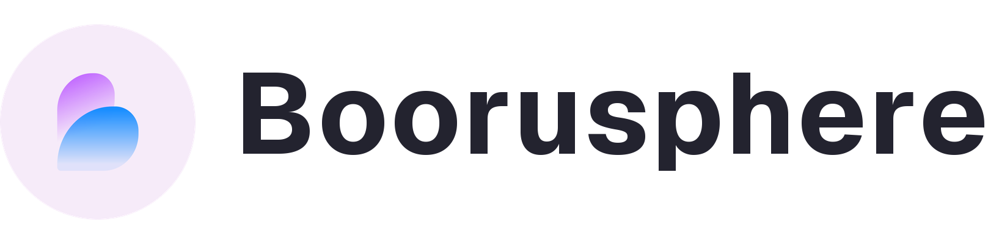
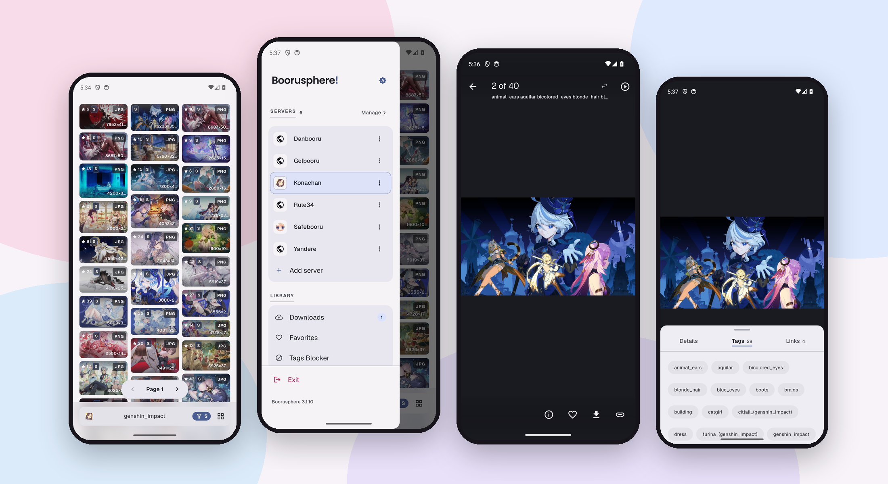

<div align="center">

<picture>
  <source media="(prefers-color-scheme: dark)" srcset="assets/readme/branding/lockup-dark.png">
  
</picture>

<p><b>Your boorus. One quiet app.</b></p>

<p>
  <a href="https://github.com/azrim/boorusphere/stargazers">
    
  </a>
  <a href="https://github.com/azrim/boorusphere/releases/latest">
    
  </a>
  <a href="https://github.com/azrim/boorusphere/actions">
    
  </a>
  <a href="https://github.com/azrim/boorusphere/blob/main/LICENSE.md">
    
  </a>
</p>

<p>
  <a href="https://github.com/azrim/boorusphere/releases/latest">
    <picture>
      <source media="(prefers-color-scheme: dark)" srcset="assets/readme/badges/releases-dark.png">
      
    </picture>
  </a>
</p>

<p><sub>Android 7.0+ · arm64, armv7, x86_64 or universal</sub></p>

</div>

## <picture><source media="(prefers-color-scheme: dark)" srcset="assets/readme/icons/section-screenshots-dark.svg"></picture> Screenshots

<picture>
  <source media="(prefers-color-scheme: dark)" srcset="assets/readme/showcase-dark.png">
  
</picture>

---

## <picture><source media="(prefers-color-scheme: dark)" srcset="assets/readme/icons/section-features-dark.svg"></picture> Features

<table>
  <tr>
    <td width="50%" valign="top">
      <p>
        <picture>
          <source media="(prefers-color-scheme: dark)" srcset="assets/readme/icons/feature-grid-dark.svg">
          
        </picture>
        <br><b>A grid that talks</b>
      </p>
      <p>
        Score, rating, format and dimensions sit on every card, so most
        decisions happen before you open anything; a video adds its own mark.
        Suggestions come from the board itself, and the history keeps recent
        queries with an undo for the row you just deleted.
      </p>
    </td>
    <td width="50%" valign="top">
      <p>
        <picture>
          <source media="(prefers-color-scheme: dark)" srcset="assets/readme/icons/feature-viewer-dark.svg">
          
        </picture>
        <br><b>A viewer that leaves the room</b>
      </p>
      <p>
        Tap once and the chrome disappears, system bars included. Pinch or
        double-tap to zoom, page horizontally or vertically, swipe up for
        details and down to dismiss. Paging direction and the swipe actions
        live in gesture settings.
      </p>
    </td>
  </tr>
  <tr>
    <td width="50%" valign="top">
      <p>
        <picture>
          <source media="(prefers-color-scheme: dark)" srcset="assets/readme/icons/feature-media-dark.svg">
          
        </picture>
        <br><b>Video and slideshows</b>
      </p>
      <p>
        Videos and animated images play inline, with the
        <code>Referer</code> and <code>User-Agent</code> headers pickier
        boards require. A slideshow can walk the page forward, backward or at
        random on an interval you set.
      </p>
    </td>
    <td width="50%" valign="top">
      <p>
        <picture>
          <source media="(prefers-color-scheme: dark)" srcset="assets/readme/icons/feature-filter-dark.svg">
          
        </picture>
        <br><b>Tags Blocker</b>
      </p>
      <p>
        The blocker takes expressions, not just single tags: a space means
        AND, <code>~</code> means OR, and <code>-</code> excludes. A page
        emptied by a filter names it and offers the control that brings the
        posts back; explicit thumbnails can blur on the timeline or everywhere.
      </p>
    </td>
  </tr>
  <tr>
    <td width="50%" valign="top">
      <p>
        <picture>
          <source media="(prefers-color-scheme: dark)" srcset="assets/readme/icons/feature-favorites-dark.svg">
          
        </picture>
        <br><b>Tags and batches</b>
      </p>
      <p>
        Long-press to select posts, then favorite, download or share the batch.
        The details sheet splits into details, tags and links; select tags in
        bulk to copy, block, append to the query or search, and <b>Find
        related</b> turns a post's own tags into the next search.
      </p>
    </td>
    <td width="50%" valign="top">
      <p>
        <picture>
          <source media="(prefers-color-scheme: dark)" srcset="assets/readme/icons/feature-downloads-dark.svg">
          
        </picture>
        <br><b>Downloads that finish</b>
      </p>
      <p>
        Pause, resume and retry — one file or every failed one — with four
        transfers in flight. Files land in <code>Downloads/Boorusphere/</code>,
        optionally in per-server folders, each with a sidecar record of the
        post. The library reopens, redownloads or clears that record later,
        and one switch keeps the collection out of your gallery.
      </p>
    </td>
  </tr>
  <tr>
    <td width="50%" valign="top">
      <p>
        <picture>
          <source media="(prefers-color-scheme: dark)" srcset="assets/readme/icons/feature-boards-dark.svg">
          
        </picture>
        <br><b>Every board</b>
      </p>
      <p>
        Ten presets ship with the app: Danbooru, Gelbooru, Konachan, Yandere,
        Safebooru, Rule34, e621, Derpibooru, Ponybooru and Rule34 Paheal.
        Any other board is added by address: <b>Scan</b> reads it and picks
        the engine, or choose Danbooru, Gelbooru 0.1.x/0.2, Moebooru, e621,
        Shimmie, Szurubooru or Philomena yourself.
      </p>
    </td>
    <td width="50%" valign="top">
      <p>
        <picture>
          <source media="(prefers-color-scheme: dark)" srcset="assets/readme/icons/feature-archive-dark.svg">
          
        </picture>
        <br><b>Quietly yours</b>
      </p>
      <p>
        Backups carry settings, servers, search history, blocked tags and
        favorites in one archive. Download records can ride along, a
        passphrase can seal it, and the scheduler can send a copy to your own
        Telegram bot every day, week or month — with <b>Backup now</b> when
        you would rather not wait.
      </p>
    </td>
  </tr>
  <tr>
    <td width="50%" valign="top">
      <p>
        <picture>
          <source media="(prefers-color-scheme: dark)" srcset="assets/readme/icons/feature-quiet-dark.svg">
          
        </picture>
        <br><b>Locked down</b>
      </p>
      <p>
        A PIN or biometrics can lock the app, with a guess throttle that
        survives restarts, and a switch hides it from recents and blocks
        screenshots. The cache screen shows how much space videos take and
        caps them at 100 MB, 300 MB, 500 MB or 1 GB; one confirmed
        <b>Clear</b> wipes images and videos together.
      </p>
    </td>
    <td width="50%" valign="top">
      <p>
        <picture>
          <source media="(prefers-color-scheme: dark)" srcset="assets/readme/icons/feature-themes-dark.svg">
          
        </picture>
        <br><b>Dress it how you like</b>
      </p>
      <p>
        Light, dark or system; <b>Midnight</b> turns dark into true black for
        OLED screens. Colors can come from your wallpaper on Android 12+, the
        Material You seed, or ten curated editor palettes. The chrome is
        flat-first, high-refresh screens are supported, and the layout is
        edge-to-edge with an optional blur.
      </p>
    </td>
  </tr>
</table>

---

## <picture><source media="(prefers-color-scheme: dark)" srcset="assets/readme/icons/feature-downloads-dark.svg"></picture> Install

Boorusphere is sideloaded from this repository; there is no Play Store listing.
Download the newest APK from [Releases](https://github.com/azrim/boorusphere/releases/latest)
and match it to your phone:

| APK | Pick it when |
| --- | --- |
| `boorusphere-<version>-arm64-v8a.apk` | Almost every phone from 2017 onward. **The default choice.** |
| `boorusphere-<version>-armeabi-v7a.apk` | Older 32-bit phones. |
| `boorusphere-<version>-x86_64.apk` | Android emulators and x86_64 Chromebooks. |
| `boorusphere-<version>-universal.apk` | One file for all of the above. First installs only. |

Android 7.0 (API 24) or newer. Installed copies update in place through the
app's updater, which fetches the split APK for your ABI. A manually downloaded
APK must be the same variant or carry a newer version code.

---

## <picture><source media="(prefers-color-scheme: dark)" srcset="assets/readme/icons/section-development-dark.svg"></picture> Development

Boorusphere is a Flutter/Dart Android app. The UI and state live in
`lib/presentation` on Riverpod; `lib/domain` holds the repository interfaces
and `lib/data` the implementations, including the booru parsers that translate
each board's JSON or XML into one post. Generated sources are not checked in,
so run the generators once after cloning.

You need Flutter **3.44.0+** and Dart **3.12+** (both pinned in `pubspec.yaml`),
JDK 17 and a working Android SDK.

```bash
git clone https://github.com/azrim/boorusphere.git
cd boorusphere
flutter pub get
dart pub global activate grinder
grind gencode
grind genlang
flutter run
```

<details>
<summary><b>Grinder tasks, CI and release builds</b></summary>
<br>

| Task | Does |
| --- | --- |
| `grind gencode` | Regenerate code with build_runner |
| `grind genlang` | Regenerate strings with slang, plus the missing-translation report |
| `grind pigeons` | Regenerate platform-channel bindings |
| `grind chkfmt` | Check formatting the way CI does |
| `grind analyze` | Run `flutter analyze` |
| `grind test` | Run `flutter test --coverage` |
| `grind chkall` | Format, analyze and test in one go |
| `grind apkarm64` | Build the arm64 split release APK |
| `grind apkrelease` | Build every split ABI plus the universal APK |

Every pull request and every push to `main` runs CI: generators, `chkfmt`,
`analyze` and the test suite. Unformatted code fails the build, so run
`grind chkfmt` before pushing.

The **Build APK** workflow runs on `v*` tags and on manual dispatch; it builds
every split ABI plus the universal APK and, on a tag, attaches them to the
matching GitHub Release. Release builds use the keystore behind
`ANDROID_KEYSTORE_BASE64`, `ANDROID_KEYSTORE_PASSWORD`, `ANDROID_KEY_ALIAS` and
`ANDROID_KEY_PASSWORD`; without them the workflow warns and falls back to debug
signing, which cannot update an earlier install.

To cut a release, bump `version:` in `pubspec.yaml`, add a `## X.Y.Z` section
at the top of [`CHANGELOG.md`](CHANGELOG.md), then tag `vX.Y.Z`.

Read [`DESIGN.md`](DESIGN.md) before touching surfaces, palettes or viewer
chrome; [`GLOSSARY.md`](GLOSSARY.md) pins down the vocabulary.

</details>

---

## <picture><source media="(prefers-color-scheme: dark)" srcset="assets/readme/icons/section-faq-dark.svg"></picture> FAQ

<details>
<summary><b>Which APK should I download?</b></summary>
<br>

Start with `boorusphere-<version>-arm64-v8a.apk`; nearly every phone since 2017
is arm64. `armeabi-v7a` covers older 32-bit phones, `x86_64` emulators and
x86_64 Chromebooks, and the universal APK is one file for all of them — a
first-install fallback. Android 7.0 (API 24) or newer.

</details>

<details>
<summary><b>Why does Android refuse to install an update?</b></summary>
<br>

Android compares version codes, not version names. A split APK carries an ABI
offset (arm64 is 2000 plus the build number) while the universal APK carries
the bare build number, so the universal build has a lower code than any split
and cannot replace one. The in-app updater fetches the split for your ABI; a
manual APK must be the same variant or newer. Mixing variants reads as a
downgrade, and One UI reports "App not installed as package appears to be
invalid".

</details>

<details>
<summary><b>A board asks for an API key or user id. Where do I put it?</b></summary>
<br>

Some boards rate-limit anonymous use or ask for an account before they return
everything. Open the server's settings and fill the user id (or login) and API
key it asks for. They stay on your device and are sent only to that board.

</details>

<details>
<summary><b>Why did a page come back empty?</b></summary>
<br>

Usually a rating filter or the Tags Blocker. A page emptied by a filter says
which one hid it and offers the control that brings the posts back. Rating
filters are per server; the blocker takes expressions where a space means AND,
`~` means OR, and `-` excludes.

</details>

<details>
<summary><b>Where do downloads go?</b></summary>
<br>

Under `Downloads/Boorusphere/`, optionally in a folder per server. Each file
gets a sidecar record of the post it came from, and the Downloads library can
reopen, redownload or clear that record later. One switch keeps the whole
collection out of your gallery.

</details>

<details>
<summary><b>Can I move my setup to a new phone?</b></summary>
<br>

Yes. A backup archive carries settings, servers, search history, blocked tags
and favorites; download records can ride along, and a passphrase can seal it.
Restore it on the new phone. The scheduler can also send a copy to your own
Telegram bot every day, week or month, and **Backup now** sends one
immediately.

</details>

<details>
<summary><b>Does Boorusphere collect anything?</b></summary>
<br>

No account, no analytics, and no server of ours. Favorites, blocklists,
settings and backups stay on your device. Requests go straight to the boards
you add; the only optional upload is a backup to a Telegram bot you own.

</details>

<details>
<summary><b>A video refuses to play. Why?</b></summary>
<br>

Videos and animated images play inline with the `Referer` and `User-Agent`
headers pickier boards require. If a clip still refuses, the board is likely
serving a format or codec the device cannot decode; the post's links in the
details sheet open in the browser.

</details>

<details>
<summary><b>How do I add a board that is not in the list?</b></summary>
<br>

Add it by address. **Scan** reads the site and picks its engine, or choose one
yourself from Danbooru, Gelbooru (0.2), Gelbooru (0.1.x), Moebooru, e621,
Shimmie, Szurubooru and Philomena. Each server keeps its own query templates,
rating filter, credentials and blocked-tag list.

</details>

<details>
<summary><b>How do I help translate?</b></summary>
<br>

Copy `i18n/strings_en.i18n.json` to `i18n/strings_<code>.i18n.json`, translate,
then run `grind genlang` locally. Untranslated keys fall back to English, so
partial locales are welcome; open a pull request with the new file.

</details>

---

## <picture><source media="(prefers-color-scheme: dark)" srcset="assets/readme/icons/section-contributors-dark.svg"></picture> Contributors

Thanks to everyone who has contributed to Boorusphere!

<a href="https://github.com/azrim/boorusphere/graphs/contributors">
  
</a>

The app ships with German, Filipino, Indonesian, Japanese, Russian, Thai,
Turkish, Ukrainian, Simplified Chinese and Traditional Chinese — and uwu,
because of course it does. Untranslated keys fall back to English, so partial
locales are welcome.

Bug reports and pull requests are welcome. Keep a pull request to one concern,
run `grind chkfmt`, `grind analyze` and `grind test` before pushing, and write
user-facing changes into [`CHANGELOG.md`](CHANGELOG.md) under the next version.

---

## <picture><source media="(prefers-color-scheme: dark)" srcset="assets/readme/icons/section-credits-dark.svg"></picture> Credits and license

Boorusphere is released under the [BSD 3-Clause License](LICENSE.md),
© 2021 Chaldeaprjkt. Built with [Flutter](https://flutter.dev) and a pile of
good packages; the bundled Geist, Poppins and Noto Sans Thai fonts ship under
the SIL Open Font License.

Boorusphere is an unofficial client and hosts nothing. Every post belongs to
the board it came from and the people who made it; follow their rules and
licenses. The software is provided "as-is", without warranty of any kind.

> [!TIP]
> **Star the repo** to get notified about new releases from GitHub.
